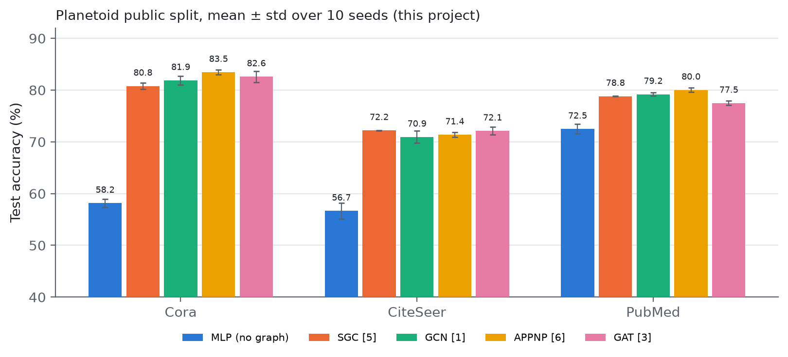
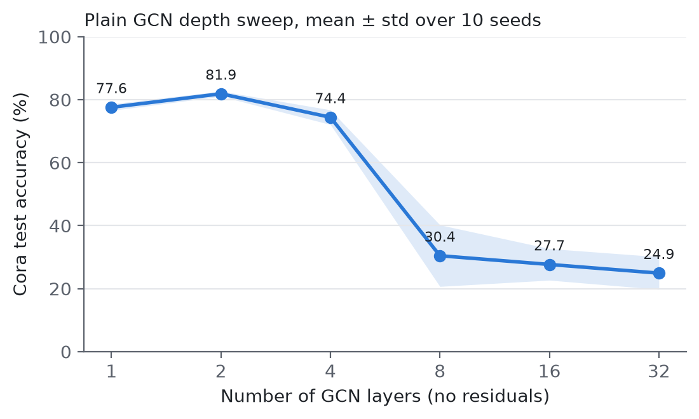
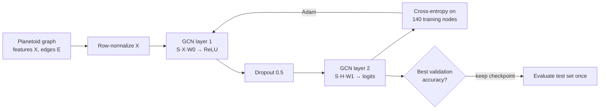

# Graph Neural Networks for Semi-Supervised Node Classification

**A literature survey, lecture, and reproducible PyTorch baseline**

CMPE 260 · San Jose State University
Kalhar Patel · Dev Mulchandani · Deep Dhaduk · Nikita Memane

   

---

## At a glance

| | |
|---|---|
| **Topic** | How graph neural networks use edges to classify nodes when only a few nodes are labeled, and when they fail |
| **Surveyed papers** | 10 refereed papers (ICLR, NeurIPS, ICML, 2017–2020), plus 6 supporting references |
| **Baseline** | Two-layer Graph Convolutional Network (Kipf & Welling, ICLR 2017) in PyTorch Geometric |
| **Controls** | MLP without edges, SGC, APPNP, and GAT, all trained under the same protocol |
| **Evaluation** | Cora / CiteSeer / PubMed, public Planetoid split, 10 seeds per model, plus a depth sweep |
| **Headline** | Our GCN reaches **81.9 ± 0.8 %** on Cora (the paper reports 81.5 %); removing edges drops accuracy to 58.2 %; a plain GCN collapses at 8+ layers |

## Deliverables

| Deliverable | File | Notes |
|---|---|---|
| 📄 **Survey paper, IEEE two-column** | [`report/ieee/GNN_Survey_IEEE.tex`](report/ieee/GNN_Survey_IEEE.tex) · [Overleaf zip](report/GNN_Survey_IEEE_overleaf.zip) | IEEEtran; ~9,000 words; 13 equations, 5 figures, 5 tables |
| 📝 Survey, Word version | [`report/GNN_Literature_Survey.docx`](report/GNN_Literature_Survey.docx) | Same text, native Word equations |
| 🎓 **Lecture slides (62)** | [`presentation/GNN_Lecture_60_Slides.pptx`](presentation/GNN_Lecture_60_Slides.pptx) | Editable PowerPoint with speaker notes; open in PowerPoint (Keynote leaves the charts blank) |
| 💻 **Baseline code** | [`code/`](code/) | GCN plus controls, evaluation, experiments, tests |
| 📊 Results | [`results/`](results/) | Raw per-run CSV and summaries quoted in the paper and slides |
| 🖼️ Figures | [`figures/`](figures/) | Regenerated by `code/make_figures.py` |

## Results

All numbers below come from `code/run_experiments.py` (see [`results/summary.csv`](results/summary.csv)). Test accuracy (%), mean ± std over 10 seeds:

| Model | Cora | CiteSeer | PubMed | Original paper (public split) |
|---|---|---|---|---|
| MLP (no edges) | 58.2 ± 0.8 | 56.7 ± 1.6 | 72.5 ± 0.9 | — |
| SGC | 80.8 ± 0.6 | 72.2 ± 0.0 | 78.8 ± 0.0 | 81.0 / 71.9 / 78.9 |
| **GCN (baseline)** | **81.9 ± 0.8** | **70.9 ± 1.2** | **79.2 ± 0.3** | **81.5 / 70.3 / 79.0** |
| APPNP | 83.5 ± 0.5 | 71.4 ± 0.5 | 80.0 ± 0.4 | different protocol |
| GAT | 82.6 ± 1.1 | 72.1 ± 0.7 | 77.5 ± 0.4 | 83.0 / 72.5 / 79.0 |

<p align="center">
  
</p>

**What the numbers show**

* **The graph does most of the work.** Using edges adds 23.7, 14.3 and 6.7 points over the MLP. These graphs are strongly homophilous: 74–81 % of edges join same-class papers.
* **The baseline reproduces the paper.** Our GCN gets 81.9 / 70.9 / 79.2; Kipf & Welling report 81.5 / 70.3 / 79.0.
* **Nonlinearity adds little here.** SGC, a linear model on pre-smoothed features, is within 1.3 points of the GCN and trains 10–13× faster in our runs.
* **Fancier models give small, inconsistent gains.** Only APPNP beats the GCN on all three datasets. GAT, run with one configuration for every dataset, falls below the GCN on PubMed.
* **Depth hurts.** Accuracy peaks at 2 layers (81.9 %), drops to 74.4 % at 4, and collapses to about 30 % at 8 or more layers. That is below the 31.9 % you get by always predicting the most common class (over-smoothing, see Oono & Suzuki).

<p align="center">
  
</p>

These results come from one public split with published hyperparameters and no per-dataset tuning, so they demonstrate the methods and are not a leaderboard. Section XV of the paper discusses the limitations.

## How the baseline works



The model is `Z = softmax( S · ReLU( S · X · W0 ) · W1 )` with `S = D̃^(-1/2) (A + I) D̃^(-1/2)`. It uses 16 hidden units, dropout 0.5, Adam with learning rate 0.01, weight decay 5e-4, and 200 epochs. The checkpoint with the best **validation** accuracy is kept (ties go to the lower validation loss), and the **test** set is scored exactly once, after training.

| `--model` | What it is | Question it answers |
|---|---|---|
| `gcn` | Two-layer GCN (Kipf & Welling, 2017) | **baseline** |
| `mlp` | Two-layer MLP, edges ignored | How much do edges help? |
| `sgc` | SGC, K = 2 (Wu et al., 2019) | Is the nonlinearity needed? |
| `appnp` | APPNP, K = 10, α = 0.1 (Klicpera et al., 2019) | Does long-range diffusion help? |
| `gat` | GAT, 8 heads (Veličković et al., 2018) | Do learned neighbor weights help? |

## Quick start

**Requirements:** Python 3.10+ (tested on 3.11). Internet access is needed once, to download the datasets (a few MB). No GPU needed.

```bash
cd code
python -m venv .venv
source .venv/bin/activate            # Windows PowerShell: .venv\Scripts\Activate.ps1
python -m pip install --upgrade pip
python -m pip install -r requirements.txt

python -m pytest -q tests            # 13 offline tests, ~5 s
python train.py --dataset Cora --seed 42
```

Expected output (CPU, ~5 s): the best epoch is 151, validation accuracy 0.798, and **test accuracy 0.815**. Compare with [`results/gcn_cora_seed42/metrics.json`](results/gcn_cora_seed42/metrics.json). Other hardware or library versions may shift this slightly.

For a CUDA GPU, install the matching PyTorch wheel from <https://pytorch.org/get-started/locally/> first, then install `requirements.txt`. Tested versions: torch 2.15.0, torch-geometric 2.8.1, numpy 2.4.6, scipy 1.17.1.

## Usage

All commands run from `code/` with the virtual environment active.

```bash
# Train any model on any dataset
python train.py --model gcn --dataset CiteSeer --output-dir results_citeseer
python train.py --model gat --dataset Cora     --output-dir results_gat
python train.py --num-layers 8 --dataset Cora  --output-dir results_gcn8   # deep plain GCN
python train.py --help                                                    # all options

# Inference: reload a checkpoint, print metrics, the confusion matrix and per-node predictions
python evaluate.py --checkpoint results/best_model.pt --nodes 0 1 1708

# Reproduce every table and figure in the paper
python dataset_stats.py                 # dataset table
python run_experiments.py               # 5 models × 3 datasets × 10 seeds + depth sweep (~35 min, CPU)
python run_experiments.py --quick       # 2 seeds, Cora only (~1 min sanity check)
python train.py --dataset Cora --seed 42 --output-dir results/gcn_cora_seed42
python make_figures.py --results results/experiments --history results/gcn_cora_seed42/history.csv
```

Each training run writes `metrics.json` (accuracy, macro-F1, best epoch, time, library versions, full config), `history.csv` (per-epoch curves), and `best_model.pt` into its `--output-dir`.

## Compiling the IEEE paper

* **Overleaf:** *New Project → Upload Project →* select [`report/GNN_Survey_IEEE_overleaf.zip`](report/GNN_Survey_IEEE_overleaf.zip), then compile with pdfLaTeX. IEEEtran is built in.
* **Local TeX Live / MacTeX:** `cd report/ieee && pdflatex GNN_Survey_IEEE.tex && pdflatex GNN_Survey_IEEE.tex`. Run it twice so cross-references resolve.

The paper, the Word version and the zip are all generated from one source, [`report/survey.md`](report/survey.md). After editing it, run `cd report && ./build_report.sh` (needs pandoc ≥ 3). To rebuild the slides from the result files: `cd presentation && npm install pptxgenjs@3.12.0 && node build_deck.js`.

## Repository structure

```
Project 3/
├── README.md
├── report/
│   ├── survey.md                     single source of the paper (Markdown + LaTeX math)
│   ├── ieee/GNN_Survey_IEEE.tex      IEEE two-column paper  (+ ieee/figures/)
│   ├── GNN_Survey_IEEE_overleaf.zip  upload-ready Overleaf project
│   ├── GNN_Literature_Survey.docx    Word version
│   ├── make_ieee.py                  survey.md → IEEEtran LaTeX
│   ├── build_report.sh               rebuilds .tex, .docx and the zip
│   └── reference.docx                Word styles used by pandoc
├── presentation/
│   ├── GNN_Lecture_60_Slides.pptx    62-slide lecture deck
│   └── build_deck.js                 regenerates the deck from ../results
├── code/
│   ├── models.py                     GCN (baseline), MLP, SGC, APPNP, GAT
│   ├── train.py                      training, validation-based selection, single test evaluation
│   ├── evaluate.py                   checkpoint reload, metrics, confusion matrix, node predictions
│   ├── run_experiments.py            multi-seed study + depth sweep
│   ├── dataset_stats.py              dataset statistics and edge homophily
│   ├── make_figures.py               all report figures
│   ├── tests/test_smoke.py           offline tests (synthetic graph)
│   └── requirements.txt
├── results/                          outputs quoted in the paper and slides
├── figures/                          figures used in the paper
└── archive/v1/                       first draft of report, deck and code (kept for reference)
```

## Surveyed papers

| # | Paper | Venue |
|---|---|---|
| 1 | Kipf & Welling, *Semi-Supervised Classification with Graph Convolutional Networks* | ICLR 2017 |
| 2 | Hamilton, Ying & Leskovec, *Inductive Representation Learning on Large Graphs* (GraphSAGE) | NeurIPS 2017 |
| 3 | Veličković et al., *Graph Attention Networks* | ICLR 2018 |
| 4 | Xu, Hu, Leskovec & Jegelka, *How Powerful are Graph Neural Networks?* (GIN) | ICLR 2019 |
| 5 | Wu et al., *Simplifying Graph Convolutional Networks* (SGC) | ICML 2019 |
| 6 | Klicpera, Bojchevski & Günnemann, *Predict then Propagate* (APPNP) | ICLR 2019 |
| 7 | Oono & Suzuki, *Graph Neural Networks Exponentially Lose Expressive Power for Node Classification* | ICLR 2020 |
| 8 | Zeng et al., *GraphSAINT: Graph Sampling Based Inductive Learning Method* | ICLR 2020 |
| 9 | Hu et al., *Open Graph Benchmark* | NeurIPS 2020 |
| 10 | Pei et al., *Geom-GCN: Geometric Graph Convolutional Networks* | ICLR 2020 |

Full IEEE-style references, including the six supporting ones, are at the end of the paper.

## Troubleshooting

| Symptom | Fix |
|---|---|
| `No module named 'scipy'` while loading the dataset | `pip install -r requirements.txt` (PyG needs scipy to read the raw Planetoid files) |
| Download fails on first run | Needs access to `github.com/kimiyoung/planetoid`; or copy an existing `data/<Dataset>/` folder into `code/data/` |
| Error about a corrupt or partial dataset | Delete `code/data/<Dataset>` and rerun |
| `--device cuda requested but CUDA is not available` | Use `--device cpu` or install a CUDA build of PyTorch |
| `No module named torch_geometric` | Activate the virtual environment (`which python` should point into `.venv`) |
| Numbers differ slightly from ours | Expected across hardware and library versions; compare means over seeds |

## Scope and honesty notes

* Every number labelled "this project" was produced by the scripts above. Every number credited to a paper was checked against that paper.
* The experiments are transductive: all node features and edges are visible during training, but test labels never are. They use one public split per dataset with published hyperparameters.
* GraphSAGE, GIN, GraphSAINT and Geom-GCN are surveyed but not implemented. Their defining settings (inductive learning, graph classification, very large graphs, heterophilous graphs) differ from Planetoid.

## Acknowledgments

Algorithms by Kipf & Welling (GCN), Wu et al. (SGC), Klicpera et al. (APPNP) and Veličković et al. (GAT). Built with [PyTorch](https://pytorch.org) and [PyTorch Geometric](https://pyg.org) (Fey & Lenssen, 2019). Datasets: Cora, CiteSeer and PubMed (Sen et al., *AI Magazine* 2008) with the Planetoid splits (Yang et al., ICML 2016).
