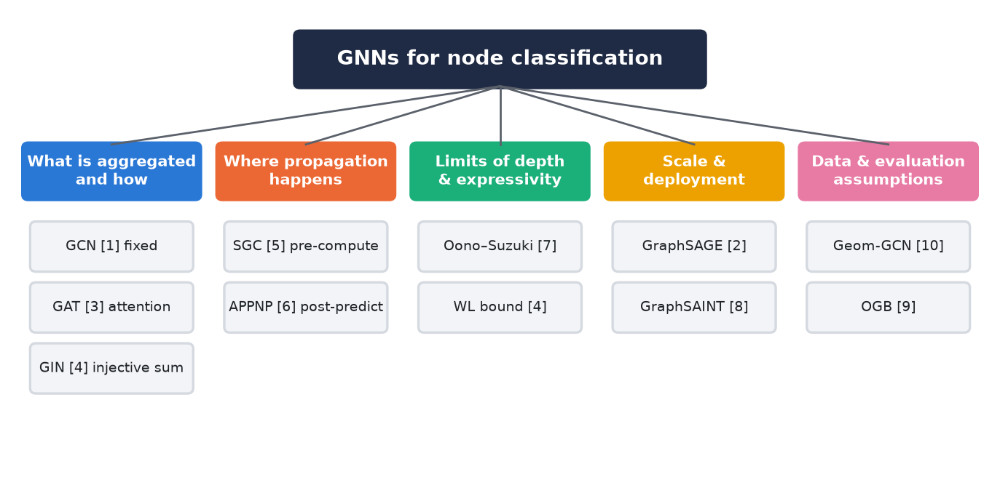
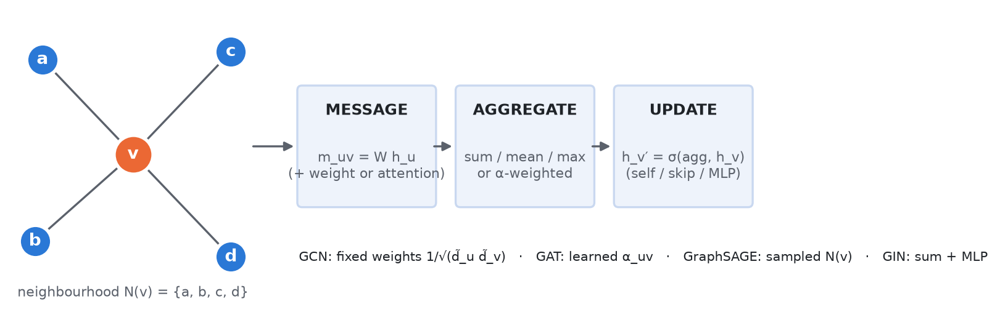
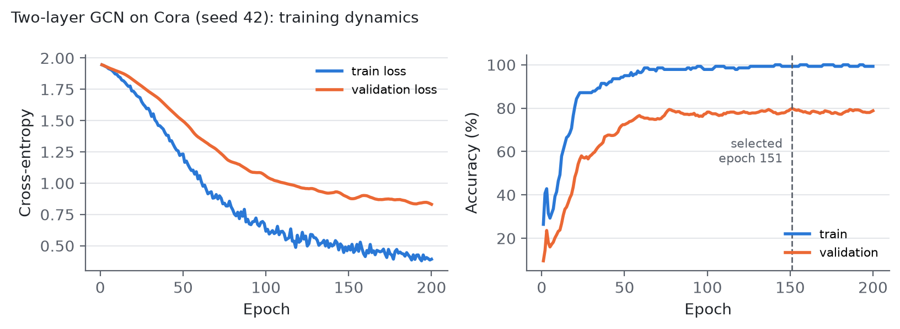
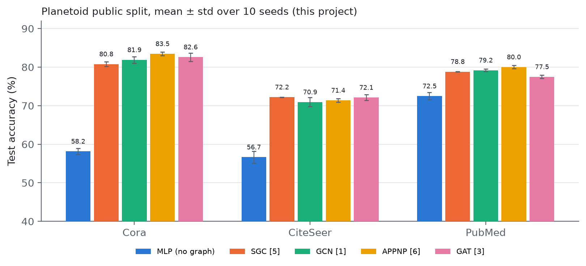
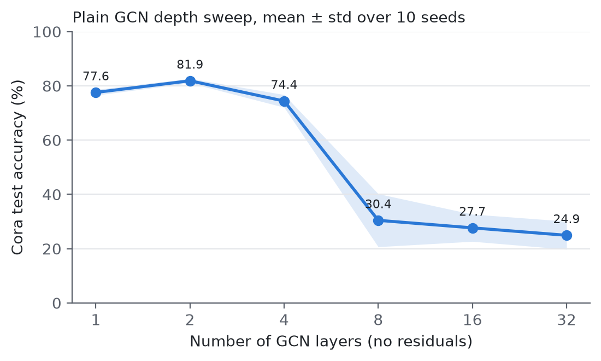

**Code repository:** <https://github.com/DMgaming00/CMPE-260/tree/main/Project%203/code>

## Abstract

Graph neural networks (GNNs) learn representations from node attributes and graph connectivity by repeatedly exchanging information along edges. Their success in semi-supervised node classification stems from the ability to exploit relational structure when only a small fraction of nodes carry labels. Yet GNNs differ in their assumptions about neighborhood homogeneity, expressive capacity, computational cost, and the meaning of benchmark accuracy. This tutorial synthesizes ten peer-reviewed papers that defined the main directions of the field: graph convolutional networks (GCNs), inductive neighborhood sampling, attention-based aggregation, expressivity analysis, simplified convolution, personalized-PageRank propagation, over-smoothing theory, subgraph sampling, large-scale benchmarking, and heterophilous neighborhood geometry. We place all of them in the message-passing framework, derive their key equations, compare them along six design axes, and separate what each paper demonstrates from what can legitimately be concluded across papers. A reproducible PyTorch Geometric implementation of the two-layer GCN accompanies the survey, with four controls (a feature-only MLP, SGC, APPNP, and GAT) and a depth sweep. Across 10 seeds on the public Planetoid splits, the GCN baseline reaches 81.9 ± 0.8 % test accuracy on Cora, close to the 81.5 % reported in the original paper, while the graph-free MLP reaches only 58.2 ± 0.8 %; removing the GCN's nonlinearity (SGC) costs at most 1.1 points, and a plain GCN collapses once it is eight or more layers deep. The synthesis shows that architectural sophistication alone does not determine performance: graph homophily, split construction, feature quality, sampling behavior, and system constraints jointly decide whether more expressive or deeper propagation is useful.

**Index Terms**—graph neural networks, node classification, graph convolution, message passing, semi-supervised learning, over-smoothing, reproducibility.

## I. Introduction

Many classification problems are relational rather than independent. A scientific publication cites other publications, a user belongs to an interaction network, a protein participates in a biological interaction graph, and a transaction connects accounts, merchants, and devices. In such settings the object to be classified is embedded in a structure that may carry predictive information beyond its own attributes. Classical supervised methods map an attribute vector to a label without using edges. Graph learning starts from the proposition that connections themselves encode evidence, while recognizing that links may also be noisy, incomplete, misleading, or shaped by the mechanism that created the dataset.

Semi-supervised node classification is a particularly instructive problem. Each vertex has an attribute vector, and labels are observed for only a small part of the graph; on the standard Cora benchmark, for example, 140 of 2,708 nodes are labeled [1], [12]. The objective is to predict the remaining labels, usually by training a function that combines node attributes with information arriving from adjacent or more distant vertices. This seemingly simple task forces several design decisions. A model must decide which neighbors to use, how to weight their messages, whether its parameters can apply to previously unseen vertices, how far information should travel, and how performance should be estimated when edges connect training and evaluation vertices.

The contemporary literature has explored these decisions through a sequence of architectural and methodological changes. Kipf and Welling's graph convolutional network provided a compact and effective way to smooth features along edges [1]. Hamilton, Ying, and Leskovec reframed embedding computation as a learned aggregation function that transfers to unseen nodes and graphs [2]. Veličković and colleagues introduced attention to make neighborhood contributions data-dependent [3]. Xu and colleagues asked whether existing aggregation functions can distinguish different neighborhood multisets [4]. Wu and colleagues challenged the assumption that graph learning requires repeated nonlinear transformations [5], and Klicpera, Bojchevski, and Günnemann separated prediction from long-range diffusion using personalized PageRank [6].

Later work clarified why depth and scale cannot be treated as routine engineering details. Oono and Suzuki analyzed conditions under which deep graph networks lose node-discriminating information [7]. Zeng and colleagues developed GraphSAINT to train on sampled subgraphs instead of expanding per-layer neighborhoods [8]. Hu and colleagues introduced the Open Graph Benchmark to improve the realism and consistency of evaluation [9]. Pei and colleagues examined graphs in which connected nodes usually do not share labels, challenging the homophily assumption that favors basic graph convolution [10]. These contributions do not form a simple progression toward one universally superior architecture; they are competing responses to distinct limitations.

This survey organizes that literature around the lifecycle of a node-classification system: problem formulation, information aggregation, inductive generalization, representational limits, propagation depth, scalable computation, and credible evaluation (Fig. 1). The papers are discussed as parts of one argument rather than as isolated abstracts, and particular attention is paid to the difference between a result claimed by an original paper and a conclusion that can be drawn across studies. Section XV reports experiments we ran ourselves with the accompanying code; every number in that section comes from those runs, and every number attributed to a paper elsewhere was checked against the paper.

## II. Problem Definition and Conceptual Background

Let $G=(V,E)$ be a graph with $n=|V|$ vertices and $m=|E|$ edges, adjacency matrix $A\in\{0,1\}^{n\times n}$, degree matrix $D=\mathrm{diag}(A\mathbf{1})$, and node-feature matrix $X\in\mathbb{R}^{n\times d}$. Each vertex has a label $y_v\in\{1,\dots,C\}$, but labels are observed only on a training subset $V_{\text{train}}\subset V$. A model $f_\theta(A,X)\in\mathbb{R}^{n\times C}$ outputs class scores for every vertex, and its parameters are fitted by minimizing the cross-entropy on observed labels,

$$\mathcal{L}(\theta) = -\frac{1}{|V_{\text{train}}|}\sum_{v\in V_{\text{train}}} \log \operatorname{softmax}\big(f_\theta(A,X)_v\big)_{y_v}. \tag{1}$$

Even though the optimizer uses only $V_{\text{train}}$, many transductive GNNs propagate features over the full graph, including vertices reserved for validation and testing. That distinction is fundamental: access to unlabeled test-node attributes or edges is not equivalent to access to their labels.

In the **transductive** protocol, the topology and features of the evaluated graph are visible during training, and the task is to infer labels of other vertices within that known structure. The citation-network experiments used to motivate GCNs belong to this family [1], [12]. An **inductive** protocol instead asks a trained model to process new nodes or entire graphs without a separately learned embedding per training vertex. Induction depends on transferable aggregation functions and compatible attributes; shared parameters alone do not guarantee strong performance after distribution shift. GraphSAGE made this operational distinction central rather than incidental [2].

Almost every model in this survey fits the **message-passing** template formalized by Gilmer et al. [11]. At layer $\ell$, node $v$ updates its representation $h_v^{(\ell)}$ from a permutation-invariant aggregation of messages from its neighbors $\mathcal{N}(v)$:

$$h_v^{(\ell+1)} = \mathrm{UPDATE}_\ell\Big(h_v^{(\ell)},\ \mathrm{AGG}_\ell\big(\{\!\{\, \mathrm{MSG}_\ell(h_v^{(\ell)}, h_u^{(\ell)}, e_{uv}) : u\in\mathcal{N}(v)\,\}\!\}\big)\Big). \tag{2}$$

The double braces denote a multiset: neighbors have no natural order, and a neighbor feature may occur more than once. The template is deliberately broad (Fig. 2). Some models use a normalized sum of neighbor features, some learn attention weights, and others pool transformed messages. Permutation invariance is necessary because the ordering of neighbors is arbitrary, but the chosen invariant operation also limits which neighborhoods can be told apart [4]. An aggregation rule is therefore not merely a computational convenience; it encodes an assumption about the information the task needs. Stacking $L$ such layers gives each node an $L$-hop receptive field.

**Homophily** is the tendency of linked nodes to share labels or attributes. Two common measurements are the edge homophily ratio used by Zhu et al. [14] and the node-level ratio used by Pei et al. [10]:

$$h_{\text{edge}} = \frac{|\{(u,v)\in E : y_u = y_v\}|}{|E|}, \qquad \beta = \frac{1}{n}\sum_{v\in V}\frac{|\{u\in\mathcal{N}(v): y_u=y_v\}|}{|\mathcal{N}(v)|}. \tag{3}$$

When a citation graph links publications in the same subject, averaging nearby features reinforces class evidence. In a heterophilous graph, neighbors systematically carry different labels, and a low-pass smoothing operator can erase rather than reveal a useful difference. Real graphs mix these regimes, and edge formation may depend on latent variables, label imbalance, popularity, or time. It is unsafe to equate connectivity with label similarity without measuring it; Geom-GCN explicitly investigates this limitation [10]. Both ratios use all labels, so they are diagnostics for understanding a dataset, never model inputs.

A complementary **spectral** perspective starts from the normalized graph Laplacian $L = I - D^{-1/2} A D^{-1/2}$, whose eigenvectors play the role of Fourier modes on the graph. Low-frequency signals vary slowly across edges, high-frequency signals change rapidly, and neighbor averaging acts as a low-pass filter. This interpretation explains much of the GCN operator [1], [5], but frequency language should not be stretched into a complete explanation of attention or deep nonlinear models; learned transformations, finite depth, normalization, and topology all alter behavior.

Empirical studies use train, validation, and test masks. The training mask drives parameter updates, the validation mask supports model selection, and the test mask provides a final estimate once all decisions are fixed. If hyperparameters are chosen after inspecting test accuracy, the test set is no longer an independent assessment. Initialization, sampling, and hardware add variability, so a responsible comparison reports split definitions, seeds, the model-selection rule, and dispersion across runs rather than a single favorable number [9].

## III. The Graph Convolutional Baseline

The graph convolutional network of Kipf and Welling [1] is the natural starting point because it makes the interaction between local topology and learned feature transformations explicit. The derivation begins with spectral graph convolution, $g_\theta \star x = U g_\theta(\Lambda) U^\top x$, where $U$ and $\Lambda$ are the eigenvectors and eigenvalues of $L$. Because the eigendecomposition is expensive, the filter is approximated by a truncated Chebyshev expansion; keeping only the first order and tying the two remaining parameters gives $g_\theta\star x \approx \theta\,(I + D^{-1/2}AD^{-1/2})\,x$. The operator $I + D^{-1/2}AD^{-1/2}$ has eigenvalues in $[0,2]$, so repeated application can be numerically unstable. Kipf and Welling therefore apply a *renormalization trick*: add self-loops, $\tilde A = A + I$, $\tilde D = \mathrm{diag}(\tilde A\mathbf{1})$, and use

$$S = \tilde D^{-1/2}\tilde A\,\tilde D^{-1/2}, \qquad H^{(\ell+1)} = \sigma\big(S\,H^{(\ell)}\,W^{(\ell)}\big), \qquad H^{(0)} = X. \tag{4}$$

Entry-wise, node $v$ receives the transformed features of each neighbor $u$, including itself, weighted by $1/\sqrt{\tilde d_u \tilde d_v}$. The symmetric normalization keeps a hub from dominating simply because it has many neighbors, and the self-loop retains each node's own features. The two-layer classifier used throughout the literature, and in our code, is

$$Z = \operatorname{softmax}\Big(S\ \mathrm{ReLU}\big(S X W^{(0)}\big)\, W^{(1)}\Big), \tag{5}$$

trained with Eq. (1). The first propagation mixes neighboring input features and projects them into a hidden space; the ReLU creates a learned intermediate representation; the second propagation maps hidden states to class logits. A small labeled subset provides gradients to shared parameters that are reused over the entire graph, and two layers give each node a two-hop receptive field.

The contribution is not only the reported accuracy. The layer is a sparse–dense matrix product, so one layer costs $O(m\,d_\ell + n\,d_\ell d_{\ell+1})$ time and memory linear in the number of edges rather than $O(n^2)$. On the Planetoid split, the original paper reports test accuracies of 81.5 % on Cora, 70.3 % on CiteSeer, and 79.0 % on PubMed [1] (Table II). For small citation graphs full-batch training is practical and conceptually clean. On very large graphs, however, even linear dependence on edges is demanding, because intermediate activations for every node at every layer must be stored for backpropagation; this pressure motivated the sampling schemes of Sections IV and X [2], [8].

The GCN layer has a clear inductive bias: neighbors are combined with graph-derived weights, not weights learned per relationship. This is beneficial when local smoothing matches the label structure and harmful when neighbors differ in reliability. Nodes of very different degree also experience different mixing; a hub aggregates evidence from many heterogeneous contexts, whereas a low-degree node receives few relational signals.

A baseline implementation must also distinguish algorithmic fidelity from paper-level reproduction. Re-implementing a two-layer GCN with the same hyperparameters demonstrates the method, but it does not guarantee every historical number: dataset versions, preprocessing, split construction, early-stopping logic, library kernels, and initialization all vary. As an example, the original paper lists 5,429 edges for Cora (as reported by Yang et al. [12]), whereas the PyTorch Geometric copy we use contains 5,278 undirected edges after duplicate removal. Section XV documents our exact choices so that observed outcomes can be interpreted rather than mistaken for unreported evidence.

## IV. From Transductive Convolution to Inductive Aggregation

GraphSAGE, introduced by Hamilton, Ying, and Leskovec [2], changes the object being learned. Earlier embedding procedures associated a learned vector with each node of a fixed graph, which becomes awkward when a platform continuously adds accounts, documents, or products. GraphSAGE instead learns *aggregation functions* that construct a representation from node features and sampled neighborhoods, so a new vertex can be embedded without fitting a parameter vector for it, provided its features and neighbors are available.

Each layer samples a fixed-size neighbor set $\mathcal{N}_S(v)$, aggregates the neighbors' current representations, concatenates the result with the node's own representation, and transforms it:

$$h_{\mathcal{N}(v)}^{(\ell+1)} = \mathrm{AGG}_\ell\big(\{h_u^{(\ell)} : u\in\mathcal{N}_S(v)\}\big), \qquad h_v^{(\ell+1)} = \sigma\Big(W^{(\ell)}\big[\,h_v^{(\ell)} \,\Vert\, h_{\mathcal{N}(v)}^{(\ell+1)}\big]\Big), \tag{6}$$

followed by $\ell_2$ normalization of $h_v^{(\ell+1)}$. The paper examines mean, max-pooling, and LSTM aggregators. Mean aggregation captures an average neighborhood profile; pooling applies an elementwise max after a learned transform and can emphasize strong responses; the LSTM aggregator is more expressive but is not permutation-invariant, so the authors apply it to a random permutation of neighbors. Because graph neighbors have no natural order, the LSTM variant's results should be read with that caveat.

Sampling is central to the scalability claim. If every layer expands over all neighbors, computation grows quickly with degree and depth. With per-layer fanouts $S_1,\dots,S_L$, the computation tree of one target node has at most $\prod_{\ell} S_\ell$ leaves, which makes minibatch cost predictable, at the price of sampling noise and an incomplete view of high-degree neighborhoods. The fanout is therefore both a systems parameter and a modeling choice: more neighbors improve coverage but increase memory and runtime, while fewer can hurt rare-class or long-range evidence.

The paper evaluates inductive classification on evolving citation and Reddit graphs and on unseen protein–protein interaction graphs [2]. This is a stronger and different objective than predicting held-out labels on a known citation graph, and raw numbers from the two protocols should not be compared as though they measured the same generalization problem. A transductive model can rely on graph relationships that will not exist at inference time; an inductive model must work with the information actually available for new observations.

GraphSAGE complements rather than replaces GCN. A mean aggregator with an appropriate transform resembles local smoothing, while sampling and learned aggregation enable more flexible deployment. The main lesson is that model identity cannot be separated from the data-access contract: before choosing GraphSAGE or a full-batch GCN, an engineer should specify whether inference targets are known during training, whether their neighborhoods are accessible, how often the graph changes, and what latency is acceptable.

## V. Adaptive Neighbor Weighting with Attention

The graph attention network (GAT) of Veličković and colleagues [3] addresses the rigidity of weighting neighbors purely by degree. Each node's features are linearly transformed, a shared attention mechanism scores every edge, and a softmax normalizes the scores over the neighborhood (self-loop included):

$$e_{vu} = \mathrm{LeakyReLU}\big(\mathbf{a}^\top[\,W h_v \,\Vert\, W h_u\,]\big), \qquad \alpha_{vu} = \frac{\exp(e_{vu})}{\sum_{k\in\mathcal{N}(v)\cup\{v\}}\exp(e_{vk})}, \qquad h_v' = \sigma\Big(\sum_{u\in\mathcal{N}(v)\cup\{v\}} \alpha_{vu} W h_u\Big). \tag{7}$$

Because $\alpha_{vu}$ depends on features, two neighbors may contribute unequally even when their degree normalizations are identical. **Multi-head attention** runs $K$ independent mechanisms; hidden layers concatenate the heads, $h_v' = \Vert_{k=1}^{K}\sigma(\sum_u \alpha_{vu}^{k}W^{k}h_u)$, and the output layer averages them. The transductive configuration in [3] uses 8 heads of 8 hidden units and dropout of 0.6 on both inputs and attention coefficients, and reports 83.0 ± 0.7 % on Cora, 72.5 ± 0.7 % on CiteSeer, and 79.0 ± 0.3 % on PubMed. The heads provide multiple learned views of the neighborhood, but their presence alone does not show that each head discovers a distinct, meaningful relation.

The appeal of GAT is flexibility without eigendecompositions or a fixed spectral basis. The authors state a per-head cost of $O(n\,d\,d' + m\,d')$, comparable to GCN [3]. Attention offers a way to model neighbors that differ in relevance, which helps when edge existence is a weak indicator of information quality. Yet attention does not repair noisy topology: the model still aggregates over the supplied edges, nodes beyond that neighborhood remain inaccessible, and if neighbors are indistinguishable in the available features their relative weights are hard to learn. Attention coefficients can support diagnostics, but they are not automatically faithful causal explanations of a prediction.

In practice, attention adds edge-level scores and their normalization. This is modest on small sparse graphs but significant on large or dense ones, and multi-head layers multiply the intermediate edge tensors. Evaluating GAT therefore requires recording hardware and measured runtime, not only parameter counts. GAT also illustrates a broader trade-off: adaptive coefficients add degrees of freedom and opportunities to overfit small labeled sets. Where a tuned GCN works reliably, any improvement should be measured against that baseline rather than attributed to attention as a generic advantage [3], [5].

## VI. Expressive Power and the Meaning of Aggregation

Xu, Hu, Leskovec, and Jegelka [4] examined a question that empirical accuracy alone cannot answer: which structural distinctions can a neighborhood-aggregation network represent? They connect the discriminative power of message passing to the 1-dimensional Weisfeiler–Lehman (WL) graph isomorphism test, which iteratively recolors nodes by hashing each node's color together with the multiset of its neighbors' colors:

$$c_v^{(t+1)} = \mathrm{HASH}\Big(c_v^{(t)},\ \{\!\{c_u^{(t)} : u\in\mathcal{N}(v)\}\!\}\Big). \tag{8}$$

Their central result is that any message-passing GNN is at most as powerful as the WL test in distinguishing graphs, and that it reaches this bound if its aggregation and update functions are injective on multisets. Common aggregators are not. Mean aggregation loses multiplicity: a neighborhood with one copy of a feature and one with three copies have the same mean. Max aggregation similarly ignores counts once the maximum is fixed. Sum aggregation, paired with a sufficiently expressive learnable map, can preserve multiset information. This leads to the Graph Isomorphism Network (GIN):

$$h_v^{(\ell+1)} = \mathrm{MLP}^{(\ell)}\Big((1+\epsilon^{(\ell)})\,h_v^{(\ell)} + \sum_{u\in\mathcal{N}(v)} h_u^{(\ell)}\Big). \tag{9}$$

The self-weight $\epsilon$ separates the node from its neighbors, and the MLP supplies the injective mapping guaranteed by the universal approximation theorem. The theory should be read with its assumptions: injectivity is proven for countable feature spaces, and the analysis shows that a GIN *can* represent WL-level distinctions, not that gradient training on finite data will find them. The paper's experiments are on graph classification, not semi-supervised node classification [4].

GIN is informative in a node-classification survey because it separates two objectives that architecture comparisons often conflate. Graph classification needs a representation of an entire graph and may require distinguishing global patterns. Semi-supervised node classification on homophilous graphs often benefits more from smoothing than from preserving every combinatorial distinction. A high-capacity multiset function can identify more structures in principle while being harder to train or less robust under sparse supervision. Expressivity is therefore a design resource whose value depends on the prediction target. It also refines how models should be compared: two architectures with the same receptive-field radius can differ in what their aggregators retain, and a more expressive architecture can still be limited by weak features, limited depth, or dataset construction.

## VII. Simplification as a Scientific Control

Wu and colleagues [5] asked whether the repeated nonlinear transformations of a GCN are necessary for its performance. Simple Graph Convolution (SGC) removes the intermediate nonlinearities, which lets the successive weight matrices collapse into one:

$$Z = \operatorname{softmax}\big(S^{K} X\,\Theta\big), \qquad \Theta = W^{(0)}W^{(1)}\cdots W^{(K-1)}. \tag{10}$$

Feature propagation becomes a fixed low-pass filter $S^K$ applied once before training. When $\bar X = S^K X$ is precomputed at cost $O(K\,m\,d)$, every optimization step is ordinary multinomial logistic regression on $\bar X$ and never touches the graph again. SGC makes the low-pass interpretation explicit: the graph is used to build smoothed attributes, and no learned nonlinear feature manipulation happens between diffusion steps. On the Planetoid splits, SGC with $K=2$ reports 81.0 ± 0.0 % on Cora, 71.9 ± 0.1 % on CiteSeer, and 78.9 ± 0.0 % on PubMed, statistically close to GCN, at a fraction of the training cost [5].

SGC is not a proof that nonlinearity is dispensable in general. It sacrifices the ability to apply a nonlinear transformation after each propagation, which may matter when structural and attribute signals interact nonlinearly. Precomputation is also not free: it needs the whole relevant graph, and substantial graph changes require propagation to be repeated, so a training-time win on a fixed graph does not describe end-to-end cost in a streaming environment.

The paper's main value is methodological. When a complex GNN outperforms a feature-only MLP, the gain may come from topology-aware smoothing rather than from the deep architecture. A sound experimental design therefore includes a feature-only baseline, a propagation-plus-linear baseline, and a tuned nonlinear GNN; the accompanying code implements exactly these three controls. They isolate the contribution of graph structure from the contribution of depth and learned transformations.

## VIII. Decoupling Prediction and Personalized Propagation

Klicpera, Bojchevski, and Günnemann [6] (the first author now publishes as J. Gasteiger) proposed predicting from features first and then propagating those predictions with personalized PageRank. The motivation was the difficulty of reaching long-range information with shallow message passing and the degradation of standard GCNs when made deeper. In PPNP, a neural network $f_\theta$ produces per-node predictions, which are then diffused by the personalized PageRank matrix with teleport probability $\alpha$:

$$H = f_\theta(X), \qquad Z_{\text{PPNP}} = \operatorname{softmax}\Big(\alpha\big(I - (1-\alpha)S\big)^{-1} H\Big). \tag{11}$$

The dense inverse is impractical for large graphs, so APPNP approximates it by power iteration:

$$Z^{(0)} = H, \qquad Z^{(k+1)} = (1-\alpha)\,S\,Z^{(k)} + \alpha H, \qquad Z = \operatorname{softmax}\big(Z^{(K)}\big). \tag{12}$$

The restart term $\alpha H$ continually reinjects the original predictions, so the update never becomes unconstrained repeated averaging, and the diffusion itself has no parameters. Each iteration costs $O(m\,C)$, so $K=10$ steps reach ten hops cheaply without ten learned layers. A small $\alpha$ permits wider diffusion and a larger $\alpha$ keeps predictions close to $H$; both $\alpha$ and $K$ are modeling choices to be selected on validation data. The paper uses $K=10$ and $\alpha=0.1$ ($\alpha=0.2$ on MS Academic) [6].

The APPNP evaluation also illustrates how strongly protocol shapes numbers. Rather than the single Planetoid split, it averages over 100 runs (20 random splits × 5 initializations) on Citeseer, Cora-ML, PubMed, and MS Academic, with a separate early-stopping set. Under that protocol it reports APPNP accuracies of 75.73 ± 0.30 %, 85.09 ± 0.25 %, 79.73 ± 0.31 %, and 93.27 ± 0.08 %, while its re-run GCN obtains 75.40 ± 0.30 %, 83.41 ± 0.39 %, 78.68 ± 0.38 %, and 92.10 ± 0.08 % [6]. These GCN numbers differ from the 70.3 % / 81.5 % / 79.0 % reported in [1] because the datasets (Cora-ML is not Cora), splits, and selection procedure differ, not because one GCN is better implemented.

The method separates *depth* from *range*. A deep network obtains a large neighborhood through many learned transformations; APPNP supplies long-range interaction through a dedicated propagation after a shallow predictor, which makes optimization less sensitive to deep stacks. Long-range access is not automatically beneficial, however: when distant neighborhoods connect unrelated classes, diffusion contaminates predictions, and a restart cannot fully compensate for an unsuitable edge pattern. SGC and APPNP can be read together. SGC propagates input features before a simple predictor, APPNP predicts from features before propagating scores, and GCN interleaves the two. The useful comparison asks *which signal should be smoothed*: raw attributes, intermediate embeddings, or class evidence.

## IX. Over-Smoothing and the Limits of Depth

Oono and Suzuki [7] gave a theoretical account of why stacking graph-convolution layers can destroy node-discriminating information. They model a GCN layer as $X\mapsto\sigma(SXW)$ and define a subspace $\mathcal{M}$ spanned by vectors determined only by the graph's connected components and node degrees. Writing $d_{\mathcal{M}}(X)$ for the distance of the representation from $\mathcal{M}$, $s$ for the largest singular value of the layer weights, and $\lambda$ for the largest magnitude of the propagation matrix's eigenvalues outside $\mathcal{M}$, they show that with ReLU

$$d_{\mathcal{M}}\big(X^{(\ell+1)}\big) \;\le\; s\,\lambda\; d_{\mathcal{M}}\big(X^{(\ell)}\big). \tag{13}$$

If $s\lambda<1$, representations approach $\mathcal{M}$ exponentially in depth; in that limit two nodes in the same component can be distinguished only by degree, so class information carried by features is lost. The result is not a theorem that every deep GNN must fail. It identifies conditions under which collapse is guaranteed and, conversely, suggests that large weights or graphs with a large spectral gap behave differently. Section XV shows the practical effect in our depth sweep: a plain GCN on Cora falls from 81.9 % at two layers to 24.9 % at 32 layers.

Over-smoothing should be distinguished from **over-squashing**, identified by Alon and Yahav [15]. Over-smoothing concerns representations becoming indistinguishable after repeated mixing. Over-squashing concerns information from an exponentially growing receptive field being compressed into a fixed-size vector through graph bottlenecks, which prevents long-range dependencies from being learned at all. Both appear when receptive fields grow, but they call for different interventions: residual connections, normalization, or decoupled diffusion address the former, whereas rewiring the graph or adding non-local edges addresses the latter. A survey that treats every deep-GNN failure as the same phenomenon risks prescribing the wrong remedy.

Combined with APPNP [6] and SGC [5], the over-smoothing analysis corrects a common misconception: reaching more of the graph does not mean learning more useful information. Useful range depends on how propagation is normalized, how original information is preserved, and whether the class signal survives aggregation. A pragmatic strategy is to begin with a shallow model, increase the propagation radius only when a task-specific hypothesis requires distant information, and monitor class separation and accuracy by depth and node degree. Depth is a hypothesis to test, not a capacity dial.

## X. Scalability Through Graph Sampling

GraphSAINT, developed by Zeng and colleagues [8], addresses training on graphs too large for full-batch computation. Neighborhood-sampling methods select output nodes and recursively gather the neighbors each layer requires; as depth and degree increase, this "neighbor explosion" makes the set of required ancestors grow rapidly. GraphSAINT changes the unit of sampling: it draws a subgraph $G_s$ and runs the *complete* GNN within it, so every layer reuses the same small node set and the per-batch cost is controlled directly.

The paper studies node, edge, and random-walk samplers [8]. They preserve different structures: independent node sampling may drop many edges between relevant vertices, whereas random-walk samplers retain connected local regions. A sampled subgraph is not a neutral slice of the graph, because the inclusion probabilities of nodes and edges change the expected aggregation and loss. GraphSAINT corrects this with two normalizations estimated in a pre-processing phase: aggregation over an edge $(u,v)$ is scaled by $\alpha_{u,v}=p_{u,v}/p_v$, and each node's loss is weighted by $1/\lambda_v$ with $\lambda_v\propto p_v$, where $p_v$ and $p_{u,v}$ are the probabilities that node $v$ and edge $(u,v)$ appear in a sampled subgraph. With these weights, minibatch aggregations and losses are unbiased estimates of their full-graph counterparts, and the paper further chooses edge probabilities to reduce variance.

A systems benefit is that subgraph computation reuses one local topology across all layers rather than constructing an expanding frontier per output node, which improves data locality and permits deeper models under a fixed memory budget. A trade-off remains between subgraph size, structural coverage, gradient variance, and the number of iterations. GraphSAINT is a *training framework* that can host many message-passing architectures; it is not a new aggregation function directly comparable to GCN or GAT. If GraphSAINT with one architecture beats a layer-sampled system with another, the difference cannot be assigned to the sampler alone. Runtime claims also require clarity about preprocessing, data loading, device transfers, and sampler implementation; a method can reduce accelerator memory while shifting work to a CPU sampler.

GraphSAGE and GraphSAINT are complementary ways of bounding graph computation: GraphSAGE bounds per-layer fanout around selected root nodes [2], and GraphSAINT bounds the subgraph on which all layers operate [8]. Their relative efficiency depends on degree distribution, depth, caching, sampler throughput, and the density of training targets, so choosing between them means measuring the whole data pipeline rather than extrapolating from asymptotic formulas.

## XI. Reliable Evaluation and the Open Graph Benchmark

Hu and colleagues [9] introduced the Open Graph Benchmark (OGB) to confront the limitations of the small citation datasets [12], [13] on which most of the methods above were first evaluated. When the same small datasets and fixed splits are reused for years, many research decisions become adapted to them and progress can appear more settled than it is. OGB supplies diverse datasets at much larger scale, task-appropriate splits, and standardized evaluators. Its contribution is methodological as well as infrastructural: it changes what can be claimed from an accuracy comparison.

Graph tasks differ in what counts as an independent future observation. A random node split may place closely related nodes in both training and test sets. For a citation network, a temporal split better approximates predicting the subject of future papers; OGB's paper-classification dataset is split by publication year for this reason. In molecular tasks, a scaffold split tests generalization to structurally different molecules, and in biology, a split by species tests transfer across organisms [9]. The guiding principle is that the partition must reflect the generalization question rather than convenience.

OGB also broadens attention beyond small graphs. Datasets ranging from thousands to millions of nodes expose bottlenecks invisible when a graph fits comfortably in memory, and node-, link-, and graph-level tasks have metrics that are not interchangeable (accuracy, ROC-AUC, Hits@K, MRR). Combining improvements on unrelated datasets into one story of architectural superiority is misleading without specifying the prediction unit, features, and split semantics.

A reproducible evaluation reports more than one accuracy value. It should specify the graph version, preprocessing, edge direction and self-loop handling, split, seeds, optimizer, training duration, model-selection rule, hardware, and software versions, and it should report a mean and dispersion over repeated runs. Comparisons should include simple and competitive baselines, since large architectures often benefit from tuning budgets unavailable to the comparison methods. OGB provides common infrastructure, but standardization cannot replace careful experimental conduct. Our own experiments use the Planetoid split to teach the baseline, not to establish state-of-the-art performance; the natural next step would be an OGB node-property dataset with its prescribed split and evaluator.

## XII. Beyond Homophily: Structural and Geometric Context

Pei and colleagues' Geom-GCN [10] addresses the implicit assumption that neighbors carry similar information. Some networks link unlike objects: a web page may link to a complementary category, interacting proteins need not share a function, and connected roles in a transaction network can be systematically different. If direct averaging erases those differences, a model can perform poorly even though topology is informative; the useful signal may lie in the pattern of unlike connections. Message passing also has two weaknesses that Geom-GCN targets explicitly: aggregation discards the *structural* relationships among neighbors, and long-range dependencies between distant but similar nodes are hard to capture.

Geom-GCN proceeds in three steps. It first maps nodes into a continuous latent space with a structure-preserving graph embedding. It then defines a *structural neighborhood* that contains both graph neighbors and nodes that are close in the latent space, and partitions each neighborhood into geometric regions by the relative position of neighbors around the target node. Finally, a *bi-level aggregation* aggregates within each (neighborhood, region) pair and then combines these virtual nodes with a learned transformation, so that information about *where* a neighbor sits is preserved rather than averaged away [10]. Pei et al. used the node homophily of Eq. (3) to characterize datasets and evaluated on low-homophily web graphs, where ordinary GCN and GAT perform poorly, as well as on the citation benchmarks. The general lesson is that the definition of a useful neighborhood is itself a modeling problem.

This changes how one should interpret an apparent failure of GCN. Poor accuracy can come from weak features, limited labels, a split that induces shift, or a graph whose edges join different classes, and these causes should be assessed separately. A single global homophily value can hide large variation by class, degree, or region; some vertices benefit from local averaging while others require relation-specific or distant signals. Zhu et al. [14] later showed that design choices such as separating ego and neighbor embeddings and combining intermediate representations help considerably under heterophily. For the Planetoid graphs we use, the measured edge homophily is high (Table III), which helps explain why simple smoothing works so well there.

Geom-GCN provides a counterweight to a simple reading of GCN and APPNP: stronger smoothing helps only when the propagated signal is useful. Conversely, a heterophily-oriented model should still be compared with attribute-only and graph-filtering baselines, since not every graph needs that machinery. Read in order, the trajectory from GCN to Geom-GCN exposes a hierarchy of testable assumptions: whether edges are relevant, whether neighbors are alike, whether their contributions should be uniform, whether multiset counts or structural positions matter, and whether graph information is stable between training and deployment.

## XIII. Comparative Synthesis

A useful comparison separates architectural axes instead of arranging papers into a leaderboard. Table I summarizes each method's mechanism, cost, and assumptions, and Table II collects the accuracies the papers themselves report together with the protocol behind each number. Six axes organize the discussion.

**Table I. Comparison of the surveyed approaches.** $n$ nodes, $m$ edges, $d$ feature width, $L$ layers, $K$ propagation steps, $S_\ell$ sampling fanout.

| Method | Core idea | Neighbor weighting | Per-layer / training cost | Setting in paper | Strengths | Limitations / assumptions |
|---|---|---|---|---|---|---|
| GCN [1] | First-order spectral filter, renormalized | Fixed $1/\sqrt{\tilde d_u\tilde d_v}$ | $O(md + nd^2)$, full batch | Transductive, citation graphs | Simple, fast, strong on homophilous graphs | Assumes smoothing helps; full-graph memory; degrades with depth |
| GraphSAGE [2] | Learn aggregator; sample neighbors | Mean / max-pool / LSTM | $O(\prod_\ell S_\ell)$ per target | Inductive, unseen nodes/graphs | Works on new nodes; minibatch training | Sampling noise; LSTM not order-invariant |
| GAT [3] | Feature-dependent attention | Learned $\alpha_{vu}$, multi-head | $O(nd d' + md')$ per head | Transductive and inductive | Adaptive weights; no spectral basis | More parameters, edge memory; weights not explanations |
| GIN [4] | Injective multiset aggregation | Sum + MLP, $(1+\epsilon)$ self term | $O(md + nd^2)$ | Graph classification | As powerful as 1-WL | Expressivity ≠ accuracy under sparse labels |
| SGC [5] | Remove nonlinearities | Fixed, $S^K$ | Precompute $O(Kmd)$, then linear model | Transductive + Reddit | Very cheap training; strong control | Linear in $S^KX$; recompute when graph changes |
| APPNP [6] | Predict, then PPR diffusion | Fixed, with restart $\alpha$ | $O(KmC)$ propagation | Transductive, random splits | Long range without deep stacks | Diffusion can spread errors under heterophily |
| Oono–Suzuki [7] | Theory of depth | — | — | Analysis | Explains over-smoothing | Bound holds under stated conditions only |
| GraphSAINT [8] | Sample subgraphs, unbiased normalization | Any GNN inside subgraph | Bounded by subgraph size | Inductive, large graphs | Avoids neighbor explosion; deep models | Sampler pre-processing; variance |
| OGB [9] | Realistic benchmarks and evaluators | — | — | Node/link/graph tasks | Standardized, scalable, meaningful splits | Benchmarks can still be overfit |
| Geom-GCN [10] | Latent-space structural neighborhoods | Bi-level, region-aware | Embedding + aggregation | Transductive, incl. heterophily | Uses distant, structurally similar nodes | Depends on chosen embedding; more complex |

**Table II. Node-classification test accuracy (%) as reported by the original papers.** Values are copied from the cited papers and checked against them; they are *not* directly comparable across rows with different protocols.

| Method | Cora | CiteSeer | PubMed | Protocol in the paper |
|---|---|---|---|---|
| GCN [1] | 81.5 | 70.3 | 79.0 | Planetoid public split [12] |
| GAT [3] | 83.0 ± 0.7 | 72.5 ± 0.7 | 79.0 ± 0.3 | Planetoid public split, 100 runs |
| SGC [5] | 81.0 ± 0.0 | 71.9 ± 0.1 | 78.9 ± 0.0 | Planetoid public split, 10 runs |
| GCN, re-run in [6] | 83.41 ± 0.39 (Cora-ML) | 75.40 ± 0.30 | 78.68 ± 0.38 | 20 random splits × 5 inits, 95 % CI |
| APPNP [6] | 85.09 ± 0.25 (Cora-ML) | 75.73 ± 0.30 | 79.73 ± 0.31 | 20 random splits × 5 inits, 95 % CI |

The first axis is **what gets aggregated**. GCN mixes transformed features through normalized edge weights; GraphSAGE aggregates sampled neighbors; GAT adds learned compatibility scores; GIN sums a neighborhood multiset before an expressive map; SGC filters input features once before classification; APPNP diffuses predictions. The choice determines whether information can be filtered nonlinearly at every layer, whether neighbor counts are preserved, and what an engineer should inspect when a method fails: attention distributions, representation variance, propagation spectra, or sampling coverage.

The second axis is **where supervision enters**. In a semi-supervised GCN, labels at training nodes shape the shared transformation through backpropagation, and features of unlabeled nodes influence labeled nodes' outputs and therefore the gradient, although their labels are never used. This is legitimate under the transductive protocol but does not correspond to a system that forbids access to future-node attributes. GraphSAGE aligns training with later-arriving nodes, and APPNP shows that label-trained predictions can themselves be the propagated objects.

The third axis is the **relationship between edges and labels**. Citation benchmarks reward low-pass smoothing because related papers cite one another, so GCN and even SGC exploit local class coherence. When edges carry complementary or role-based information, smoothing is a poor prior, and Geom-GCN and later heterophily work condition on structural context instead [10], [14]. GAT can choose among immediate neighbors but cannot invent missing structural evidence, and APPNP can diffuse errors. The label-mixing pattern of a graph is a first-order diagnostic.

The fourth axis is **information preservation**. Mean normalization stabilizes numerics but collapses distinct multisets; GIN explains why counts can matter [4]. Indiscriminate preservation, however, can fit irrelevant peculiarities of the training data. On a sparse-label dataset a stronger inductive bias can beat a theoretically more expressive family, so architectural decisions should rest on ablations and data diagnostics rather than on theoretical rankings alone.

The fifth axis is **propagation distance**. Adding GCN layers enlarges the receptive field but reduces separability [7]; APPNP reaches far with a fixed, restarted diffusion [6]; SGC precomputes a fixed number of steps [5]. These models suggest experiments that vary receptive field independently of the number of learned transformations, which can reveal whether gains come from reach, nonlinear capacity, or their interaction.

The sixth axis is **scalability and the operational objective**. GraphSAGE fanouts bound work around sampled targets, and GraphSAINT samples subgraphs with bias correction [2], [8]. Sampling changes the data distribution seen by the learner, so convergence and quality depend on graph exploration. SGC offers inexpensive training after precomputation but assumes a stable graph, and GAT pays per-edge attention costs. The right objective might be accuracy under a memory budget, latency at acceptable error, training throughput, or stability under edge updates, and no single paper optimizes all of them. Underlying all six axes is benchmarking: OGB [9] reminds the field that measured differences depend on scale, realistic partitioning, and standardized evaluators, which is why Table II must be read row by row rather than as a ranking.

## XIV. Critical Review of Research Design and Evidence

The surveyed papers make different kinds of claims. GCN and GAT are architectural proposals supported by experiments [1], [3]; GraphSAGE combines a model family with an inductive setting and a sampling strategy [2]; GIN and the Oono–Suzuki study are primarily mathematical analyses [4], [7]; SGC is a simplification and control argument [5]; APPNP introduces a diffusion construction [6]; GraphSAINT centers the efficiency and statistics of sampling [8]; OGB centers benchmark validity [9]; and Geom-GCN challenges assumptions about topology and labels [10]. Judging them by a single notion of novelty would miss the different forms of evidence they contribute.

An architecture paper demonstrates gains against chosen competitors on a finite set of datasets, which supports superiority within that protocol, not universally. Theory papers need complementary caution: GIN identifies distinctions some aggregators cannot represent, but finite networks trained on few labels may not realize them [4], and over-smoothing bounds depend on assumptions about operators and weights [7]. A model can avoid a theoretical limitation yet perform poorly because of a mismatched inductive bias, and a theoretically limited model can be entirely adequate when the target does not depend on the missing distinctions.

Four recurring confounds deserve explicit attention. **Leakage**: a transductive setting that exposes unlabeled test features is not leakage by itself, since it is part of the declared protocol; problems arise when deployment would not have those features, or when preprocessing indirectly reveals evaluation targets. **Tuning asymmetry**: a new model given dozens of tuning trials compared with an older baseline run once at defaults conflates architecture with optimization effort; search spaces, validation criteria, and budgets should be documented. **Statistical reporting**: reporting the best of several seeds inflates performance; the mean, standard deviation, and number of runs should be reported after model selection on validation data only, and decimals should not imply more precision than the run-to-run variation supports. **Cost accounting**: parameter count is not computational cost; wall-clock time, peak memory, and preprocessing cost should be measured, which matters particularly for SGC and sampling methods whose expensive steps can fall outside the timed loop [5], [8].

Interpretability claims should be limited in the same way. A GAT coefficient shows a learned relative weight within a neighborhood, but removing an edge also changes normalization and downstream embeddings, so the coefficient alone does not establish causal contribution. Faithfulness should be tested by perturbation and across seeds. Together these caveats yield one methodological rule: a comparison should isolate the mechanism under study while preserving the information-access and evaluation contracts. The experiments in the next section follow this rule as far as a course project allows.

## XV. Baseline Implementation and Experiments

### A. What was implemented

The accompanying code (directory `code/`, PyTorch 2 and PyTorch Geometric [16]) implements the two-layer GCN of Eq. (5) as the primary baseline because it is the simplest surveyed architecture that exercises the full semi-supervised training cycle while using graph structure directly [1]. To turn the controls advocated in Sections VII and XIV into actual measurements, the same training script also provides four comparison models that share data loading, optimizer, selection rule, and evaluation: a two-layer MLP that ignores edges; SGC with $K=2$ [5]; APPNP with $K=10$, $\alpha=0.1$ [6]; and a two-layer, 8-head GAT [3]. GraphSAGE, GIN, GraphSAINT, and Geom-GCN are discussed but not implemented, because their defining settings (inductive graphs, graph classification, very large graphs, and heterophilous web graphs) are outside the Planetoid protocol used here. The complete PyTorch implementation, its environment specification (`requirements.txt`), the offline tests, and all reproduction scripts are publicly available in the project repository at <https://github.com/DMgaming00/CMPE-260/tree/main/Project%203/code>.

### B. Data and protocol

We use the three Planetoid citation graphs [12], [13] with the public split: 20 labeled nodes per class for training, 500 nodes for validation, and 1,000 for testing. Node features are bag-of-words vectors, row-normalized as in [1]. Table III lists the statistics produced by `code/dataset_stats.py`.

**Table III. Datasets (PyTorch Geometric Planetoid copies, public split).** $h_{\text{edge}}$ is the edge homophily of Eq. (3).

| Dataset | Nodes | Undirected edges | Features | Classes | Train / Val / Test | Label rate | $h_{\text{edge}}$ |
|---|---|---|---|---|---|---|---|
| Cora | 2,708 | 5,278 | 1,433 | 7 | 140 / 500 / 1000 | 5.2 % | 0.81 |
| CiteSeer | 3,327 | 4,552 | 3,703 | 6 | 120 / 500 / 1000 | 3.6 % | 0.74 |
| PubMed | 19,717 | 44,324 | 500 | 3 | 60 / 500 / 1000 | 0.3 % | 0.80 |

Every model is trained full-batch with Adam on the training-mask cross-entropy of Eq. (1). After every epoch the model is evaluated without dropout on the validation mask, and the checkpoint with the highest validation accuracy is kept, with ties broken by lower validation loss. Training stops after the maximum number of epochs or after 100 epochs without improvement. The selected checkpoint is restored and the test mask is evaluated **once**. Hyperparameters follow the original papers' Planetoid settings and were not tuned on test data: GCN and MLP use 16 hidden units, dropout 0.5, learning rate 0.01, weight decay $5\times10^{-4}$, and 200 epochs; SGC uses learning rate 0.2 and weight decay $5\times10^{-5}$ for 100 epochs; APPNP uses 64 hidden units for 500 epochs; GAT uses 8 heads × 8 units, dropout 0.6, learning rate 0.005, and 500 epochs. One simplification relative to the papers is that SGC's weight decay and APPNP's per-layer regularization were not tuned per dataset. Each configuration was run with seeds 0–9. All runs used a laptop CPU (Python 3.11, PyTorch 2.15, PyTorch Geometric 2.8.1).

### C. Results

Fig. 3 shows a single GCN run. Training accuracy saturates near 100 % within about 60 epochs, while validation loss keeps decreasing slowly and validation accuracy plateaus near 80 %, the expected behavior for 140 labeled nodes and about 23,000 parameters. Dropout and weight decay keep the validation loss from rising, which is why validation-based selection, rather than a fixed epoch, determines the reported checkpoint.

**Table IV. Test accuracy (%) of our implementation, mean ± standard deviation over 10 seeds** (macro-F1 in `results/summary.csv`).

| Model | Cora | CiteSeer | PubMed | Mean train time per run, Cora (s) |
|---|---|---|---|---|
| MLP (no edges) | 58.2 ± 0.8 | 56.7 ± 1.6 | 72.5 ± 0.9 | 3.9 |
| SGC [5] | 80.8 ± 0.6 | 72.2 ± 0.0 | 78.8 ± 0.0 | 0.3 |
| **GCN [1] (baseline)** | 81.9 ± 0.8 | 70.9 ± 1.2 | 79.2 ± 0.3 | 4.5 |
| APPNP [6] | 83.5 ± 0.5 | 71.4 ± 0.5 | 80.0 ± 0.4 | 7.8 |
| GAT [3] | 82.6 ± 1.1 | 72.1 ± 0.7 | 77.5 ± 0.4 | 6.4 |

Table IV and Fig. 4 support four observations. First, **graph structure is the dominant ingredient**: the feature-only MLP is 23.7 points below GCN on Cora, 14.3 on CiteSeer, and 6.7 on PubMed. This is consistent with the high edge homophily of these graphs in Table III. Second, **the GCN baseline reproduces the original paper closely**: 81.9 / 70.9 / 79.2 compared with 81.5 / 70.3 / 79.0 in [1]. Third, **nonlinear depth adds little here**: SGC, a linear model on $S^2X$, is within 1.3 points of GCN on every dataset (Cora: 80.8 vs 81.9, CiteSeer: 72.2 vs 70.9, PubMed: 78.8 vs 79.2) and trains far faster, in line with the claim of [5]. Fourth, **the more elaborate models give small and inconsistent gains**: APPNP reaches 83.5 / 71.4 / 80.0 (+1.6, +0.4, +0.8 relative to GCN); GAT reaches 82.6 / 72.1 / 77.5 (+0.7, +1.2, -1.7 relative to GCN) on Cora / CiteSeer / PubMed. APPNP is the only model above GCN on all three graphs. GAT falls below GCN on PubMed; the GAT paper used PubMed-specific settings (eight output heads and stronger weight decay) that we did not adopt, so this gap reflects our single configuration rather than the method. These differences are of the same order as the gaps reported in Table II, but our study tunes no model, so they should be read as a demonstration under fixed published settings rather than as a ranking.

**Table V. Plain GCN depth sweep on Cora (10 seeds).**

| Layers | 1 | 2 | 4 | 8 | 16 | 32 |
|---|---|---|---|---|---|---|
| Test acc. (%) | 77.6 ± 1.0 | 81.9 ± 0.8 | 74.4 ± 2.3 | 30.4 ± 9.8 | 27.7 ± 5.0 | 24.9 ± 5.2 |

Fig. 5 and Table V show the depth experiment. Accuracy peaks at two layers (81.9 %); a single layer, which sees only immediate neighbors, reaches 77.6 %. Four layers already lose 7.5 points (74.4 %). At eight layers the plain GCN collapses to 30.4 ± 9.8 %, with large variation across seeds, and it stays below 28 % at 16 and 32 layers. Always predicting the most frequent test class would score 31.9 %, so the deep models have lost essentially all usable class information. With 16 hidden units, no residual connections, and the same learning rate, deep stacks are also harder to optimize, so this experiment shows the combined effect of repeated smoothing and optimization difficulty; it is consistent with Oono and Suzuki's analysis [7] but does not isolate it. Measuring the distance of hidden representations from the degree-determined subspace of Eq. (13) as a function of depth would isolate the smoothing mechanism and is a natural extension.

### D. Reproducing these numbers

All results can be regenerated from the repository (its `README.md` gives installation and run instructions): `python train.py` produces the single run of Fig. 3, `python run_experiments.py` produces Tables IV–V and the raw per-run file, and `python make_figures.py` redraws Figs. 3–5 from those files. The runs are seeded and use deterministic kernels where PyTorch provides them; on the same software versions and CPU, reruns reproduce the per-seed numbers. Different hardware or library versions can shift individual runs slightly, which is one reason for reporting means over seeds.

### E. Limitations of the experimental study

The study is deliberately small. It uses one split per dataset, three small homophilous graphs, untuned published hyperparameters, and transductive evaluation, so it says nothing about inductive generalization, heterophilous graphs, or large-scale training. The training masks prevent label leakage, but every node's features and edges participate in propagation, which is part of the declared transductive protocol. The standard deviations reflect initialization only, not split variability; the protocol of [6] in Table II shows that split variability can move results by several points.

## XVI. Applications, Deployment Conditions, and Failure Modes

The surveyed architectures apply to many graph-rich settings, but their assumptions change meaning across domains. In a citation network, features are text representations, edges are citations, and labels are research areas, so content and neighborhood reinforce one another. In recommendation, edges connect different entity types such as users and products, and label similarity across neighbors is not an appropriate global assumption; homogeneous GCN smoothing can then mix quantities that do not share semantics. In fraud detection, edges connect accounts, devices, and transactions, connections can be deliberately manipulated, class imbalance is severe, and labels arrive only after lengthy review, which makes timestamp leakage a primary concern. In biological interaction graphs, a protein's function need not agree with its partners', and observed edges carry assay-specific confidence that should not be treated as uniform. A published gain on a citation graph establishes none of these settings.

Production graphs are also rarely static. New vertices arrive, edges disappear, features change, and labels are delayed. Full-graph propagation can be cheap on a snapshot but too costly to repeat on every update; cached SGC features become stale [5]; sampling methods allow minibatch training but still need a strategy for collecting neighborhoods at serving time [2], [8]; and personalized diffusion requires updating propagation after graph changes [6]. System design must therefore cover update cadence, cache invalidation, latency, and behavior when parts of the graph are unavailable.

Evaluation should monitor distributions rather than only graph-wide means. Low-degree and newly created nodes have little relational evidence; high-degree nodes see large, possibly mixed neighborhoods; and minority classes surrounded by majority-class nodes risk having their signal smoothed away. Robustness to edge errors also matters, since an erroneous edge changes the messages a node receives and the effect propagates over layers. Stress tests should add, remove, or perturb plausible edges and simulate missing features. Finally, relational data raises privacy concerns: propagation can incorporate attributes of people who never supplied labels, so access control, data minimization, and governance must be settled before graph construction, not after training.

## XVII. Open Problems and Research Directions

**Local rather than global operators.** Real networks contain homophilous clusters, heterophilous bridges, hubs, and structurally equivalent but unconnected vertices, and one globally applied low-pass filter is poorly calibrated across these regimes [10], [14]. Adaptive mixtures of propagation operators are promising, but their extra flexibility should be justified by improvements on targeted diagnostic subsets.

**Topology quality versus architecture quality.** Graphs are often accepted as fixed inputs even though their construction may be incomplete, noisy, or biased. Learned edge selection and rewiring, which also address over-squashing [15], expand the hypothesis space and create new leakage opportunities; any learned graph transformation must use only information available at prediction time and be evaluated against feature-only models.

**Expressivity, generalization, and sample efficiency.** GIN-style multiset discrimination [4] preserves structural differences, while GCN-style smoothing supplies valuable bias under sparse labels [1]. Studying performance as the number of labels varies, and separating capacity from effective sample complexity, could explain why simple architectures remain competitive, as our own SGC and GCN results illustrate.

**Scalable experimentation.** Sampler choice affects gradient variance and how often rare structures are seen [2], [8]. Future comparisons should vary graph size and degree skew, document sampling distributions, and include data movement in measured runtime.

**Temporal and dynamic graphs.** Edges and features evolve between training and evaluation, and a graph can contain evidence that did not exist when an earlier prediction would have been made. Timestamp-respecting splits and neighborhood construction are needed for meaningful deployment simulations, and evaluation protocols must specify what was knowable at each moment [9].

**Uncertainty and calibration.** Propagation can amplify a locally wrong prediction across correlated neighbors, creating clusters of confident errors. Calibration tests and selective prediction are needed whenever decisions are costly.

**Benchmarks and reproducibility.** OGB raised methodological standards [9], but every benchmark can become overused. Progress depends on datasets with realistic heterophily, temporal variation, distribution shift, and documented collection, and on reporting that pairs transparent code with all measured outcomes, including unsuccessful ones.

## XVIII. Conclusion

Graph neural networks provide a flexible framework for learning from relational data, but the surveyed literature shows that their apparent simplicity conceals several distinct questions. GCN demonstrates how normalized local propagation supports semi-supervised node classification [1]. GraphSAGE extends aggregation to inductive, sampled settings [2]. GAT makes neighbor contributions data-dependent [3], and GIN clarifies which structural distinctions different aggregators can represent [4]. SGC and APPNP challenge the need for tightly coupled deep nonlinear propagation [5], [6]. Over-smoothing theory explains when increasing depth reduces node discrimination [7], while GraphSAINT reorganizes large-scale training around sampled subgraphs [8]. OGB emphasizes reproducible and realistic evaluation [9], and Geom-GCN makes clear that useful edges do not always connect same-label nodes [10].

The central conclusion is conditional rather than prescriptive. The most suitable architecture depends on the graph's label structure, the nature and timing of observed features, the required generalization setting, and resource constraints. A shallow model can be the best choice when smoothing matches the label signal; attention or structural aggregation can help when neighborhood evidence varies; sampling makes otherwise impractical computation feasible; and better evaluation can overturn claims that looked decisive on a narrow benchmark. Our experiments illustrate several of these points on a small scale: graph structure accounts for most of the accuracy on homophilous citation graphs, a linear propagation model nearly matches the GCN, and plain depth is harmful. Future graph-learning studies should accordingly include strong simple controls, explicit information-access assumptions, reproducible splits, and transparent reporting of training and testing procedures.

## Author Contributions

Each team member summarized and analyzed the following refereed papers (numbers refer to the reference list): Kalhar Patel, [1]–[3]; Dev Mulchandani, [4]–[6]; Deep Dhaduk, [7] and [8]; Nikita Memane, [9] and [10].

## References

[1] T. N. Kipf and M. Welling, "Semi-supervised classification with graph convolutional networks," in *Proc. Int. Conf. Learn. Represent. (ICLR)*, 2017. [Online]. Available: https://openreview.net/forum?id=SJU4ayYgl (arXiv:1609.02907)

[2] W. L. Hamilton, R. Ying, and J. Leskovec, "Inductive representation learning on large graphs," in *Adv. Neural Inf. Process. Syst. (NeurIPS)*, vol. 30, 2017. [Online]. Available: https://proceedings.neurips.cc/paper/2017/hash/5dd9db5e033da9c6fb5ba83c7a7ebea9-Abstract.html

[3] P. Veličković, G. Cucurull, A. Casanova, A. Romero, P. Liò, and Y. Bengio, "Graph attention networks," in *Proc. Int. Conf. Learn. Represent. (ICLR)*, 2018. [Online]. Available: https://openreview.net/forum?id=rJXMpikCZ (arXiv:1710.10903)

[4] K. Xu, W. Hu, J. Leskovec, and S. Jegelka, "How powerful are graph neural networks?," in *Proc. Int. Conf. Learn. Represent. (ICLR)*, 2019. [Online]. Available: https://openreview.net/forum?id=ryGs6iA5Km (arXiv:1810.00826)

[5] F. Wu, A. Souza, T. Zhang, C. Fifty, T. Yu, and K. Weinberger, "Simplifying graph convolutional networks," in *Proc. 36th Int. Conf. Mach. Learn. (ICML)*, PMLR vol. 97, 2019, pp. 6861–6871. [Online]. Available: https://proceedings.mlr.press/v97/wu19e.html

[6] J. Klicpera, A. Bojchevski, and S. Günnemann, "Predict then propagate: Graph neural networks meet personalized PageRank," in *Proc. Int. Conf. Learn. Represent. (ICLR)*, 2019. [Online]. Available: https://openreview.net/forum?id=H1gL-2A9Ym (arXiv:1810.05997; first author now J. Gasteiger)

[7] K. Oono and T. Suzuki, "Graph neural networks exponentially lose expressive power for node classification," in *Proc. Int. Conf. Learn. Represent. (ICLR)*, 2020. [Online]. Available: https://openreview.net/forum?id=S1ldO2EFPr (arXiv:1905.10947)

[8] H. Zeng, H. Zhou, A. Srivastava, R. Kannan, and V. Prasanna, "GraphSAINT: Graph sampling based inductive learning method," in *Proc. Int. Conf. Learn. Represent. (ICLR)*, 2020. [Online]. Available: https://openreview.net/forum?id=BJe8pkHFwS (arXiv:1907.04931)

[9] W. Hu, M. Fey, M. Zitnik, Y. Dong, H. Ren, B. Liu, M. Catasta, and J. Leskovec, "Open graph benchmark: Datasets for machine learning on graphs," in *Adv. Neural Inf. Process. Syst. (NeurIPS)*, vol. 33, 2020. [Online]. Available: https://proceedings.neurips.cc/paper/2020/hash/fb60d411a5c5b72b2e7d3527cfc84fd0-Abstract.html

[10] H. Pei, B. Wei, K. C.-C. Chang, Y. Lei, and B. Yang, "Geom-GCN: Geometric graph convolutional networks," in *Proc. Int. Conf. Learn. Represent. (ICLR)*, 2020. [Online]. Available: https://openreview.net/forum?id=S1e2agrFvS (arXiv:2002.05287)

[11] J. Gilmer, S. S. Schoenholz, P. F. Riley, O. Vinyals, and G. E. Dahl, "Neural message passing for quantum chemistry," in *Proc. 34th Int. Conf. Mach. Learn. (ICML)*, PMLR vol. 70, 2017, pp. 1263–1272. [Online]. Available: https://proceedings.mlr.press/v70/gilmer17a.html

[12] Z. Yang, W. W. Cohen, and R. Salakhutdinov, "Revisiting semi-supervised learning with graph embeddings," in *Proc. 33rd Int. Conf. Mach. Learn. (ICML)*, PMLR vol. 48, 2016, pp. 40–48. [Online]. Available: https://proceedings.mlr.press/v48/yanga16.html

[13] P. Sen, G. Namata, M. Bilgic, L. Getoor, B. Gallagher, and T. Eliassi-Rad, "Collective classification in network data," *AI Magazine*, vol. 29, no. 3, pp. 93–106, 2008, doi: 10.1609/aimag.v29i3.2157.

[14] J. Zhu, Y. Yan, L. Zhao, M. Heimann, L. Akoglu, and D. Koutra, "Beyond homophily in graph neural networks: Current limitations and effective designs," in *Adv. Neural Inf. Process. Syst. (NeurIPS)*, vol. 33, 2020. [Online]. Available: https://proceedings.neurips.cc/paper/2020/hash/58ae23d878a47004366189884c2f8440-Abstract.html

[15] U. Alon and E. Yahav, "On the bottleneck of graph neural networks and its practical implications," in *Proc. Int. Conf. Learn. Represent. (ICLR)*, 2021. [Online]. Available: https://openreview.net/forum?id=i80OPhOCVH2 (arXiv:2006.05205)

[16] M. Fey and J. E. Lenssen, "Fast graph representation learning with PyTorch Geometric," presented at the ICLR Workshop on Representation Learning on Graphs and Manifolds, 2019, arXiv:1903.02428. (Software reference; not counted among the surveyed peer-reviewed papers.)
